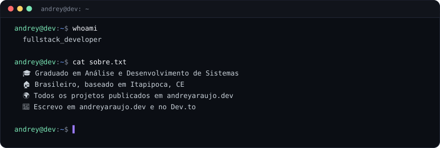

  

  
   
  

  
  
  
  
  
  

### 💻 whoami

  

<table>
<tr>
<td width="60%">

### 📊 Stats

</td>
<td width="40%">

### 🔥 Streak

</td>
</tr>
</table>

### 🛠️ Stack

  
  
  
  
  
  
   
  
  
  
  
  
  

### 🐍 Contribuições

<picture>
  <source media="(prefers-color-scheme: dark)" srcset="https://raw.githubusercontent.com/andreyaraujo-dev/andreyaraujo-dev/output/github-contribution-grid-snake-dark.svg" />
  <source media="(prefers-color-scheme: light)" srcset="https://raw.githubusercontent.com/andreyaraujo-dev/andreyaraujo-dev/output/github-contribution-grid-snake.svg" />
  
</picture>
